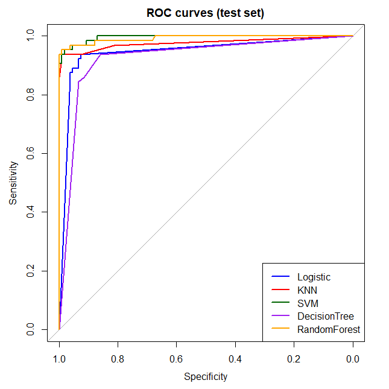
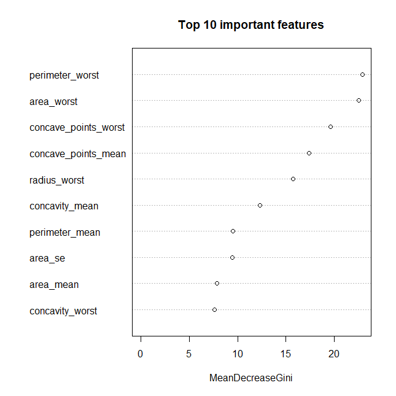

# Machine-Learning Models for Distinguishing Benign and Malignant Breast Tumors

**Comparative evaluation of five classifiers on cell-nucleus morphological features (Wisconsin Diagnostic Breast Cancer dataset), implemented in R.**


-informational)


---

## Overview

Fine-needle aspiration (FNA) is a minimally invasive way to sample a breast mass. Digitised images of the aspirate let us measure the shape and texture of the cell nuclei, and these measurements can be used to tell **benign** from **malignant** tumours.

This project asks a simple question: **how well do common machine-learning models separate benign from malignant tumours using nuclear features, and which features matter most?**

Five models are trained on the same stratified training set and compared on the same held-out test set.

## Dataset

| | |
|---|---|
| **Source** | [UCI Machine Learning Repository – Breast Cancer Wisconsin (Diagnostic)](https://archive.ics.uci.edu/dataset/17/breast+cancer+wisconsin+diagnostic) |
| **Samples** | 569 (357 benign, 212 malignant) |
| **Features** | 30 numeric features, no missing values |
| **Target** | `diagnosis`: B = benign, M = malignant |

Ten nuclear characteristics are measured for each image: radius, texture, perimeter, area, smoothness, compactness, concavity, concave points, symmetry and fractal dimension. For each one the **mean**, **standard error** (`_se`) and **worst** (largest) value are recorded, giving 30 features. Full details are in [`data/wdbc.names`](data/wdbc.names).

## Methods

1. **Preprocessing:** diagnosis recoded as a factor; features standardised (z-score) using **training-set** mean and SD only, to avoid data leakage.
2. **Split:** stratified 70/30 train/test split with `caTools::sample.split()` (`set.seed(123)`), keeping the benign/malignant ratio the same in both sets (398 train, 171 test).
3. **Models:**
   - Logistic regression
   - k-nearest neighbours (k = 7)
   - Support vector machine (radial kernel)
   - Decision tree (`rpart`)
   - Random forest (500 trees)
4. **Evaluation (test set):** accuracy, sensitivity (recall for malignant), specificity, precision, F1-score, confusion matrix and ROC/AUC.
5. **Interpretation:** random-forest feature importance (mean decrease in Gini).

## Results

### Test-set performance

| Model | Accuracy | Sensitivity | Specificity | Precision | F1 | AUC |
|---|---|---|---|---|---|---|
| **Random Forest** | **0.971** | 0.953 | 0.981 | 0.968 | 0.961 | 0.992 |
| **KNN** | **0.971** | 0.938 | 0.991 | 0.984 | 0.960 | 0.977 |
| SVM (RBF) | 0.965 | 0.953 | 0.972 | 0.953 | 0.953 | **0.995** |
| Logistic regression | 0.924 | 0.906 | 0.935 | 0.892 | 0.899 | 0.946 |
| Decision tree | 0.895 | 0.859 | 0.916 | 0.859 | 0.859 | 0.927 |

*Malignant is the positive class. Full table: [`results/model_performance.csv`](results/model_performance.csv).*

### ROC curves



The SVM, random forest and KNN curves sit close to the top-left corner, showing strong separation of the two classes. Logistic regression and the decision tree are clearly weaker.

### Most important features



Size and shape features of the **worst** (largest) nuclei dominate: `perimeter_worst`, `area_worst`, `concave_points_worst`, `concave_points_mean` and `radius_worst` are the top five. Larger nuclei with more irregular, concave outlines are the strongest signals of malignancy, which is consistent with known cytological features of cancer cells.

## Key findings

- **Random forest, KNN and SVM** performed best, with accuracy of 96–97% and AUC of 0.98–0.995.
- **Simple models trailed.** Logistic regression likely suffers from the strong correlations among the 30 features (for example radius, perimeter and area), and the single decision tree is less stable than the ensemble.
- **Concavity and size features** of the worst nuclei carry most of the predictive signal.
- In a diagnostic setting, **sensitivity** matters most, because a missed cancer costs more than a false alarm. Random forest and SVM both reached a sensitivity of 95.3%.

## Limitations

- Single dataset and a **single 70/30 split**: with only 171 test samples, one or two patients change the accuracy noticeably, so the top three models should be considered comparable rather than ranked.
- No hyperparameter tuning or repeated cross-validation; defaults (and k = 7 for KNN) were used.
- No external validation on an independent cohort.
  

## Repository structure

```
wdbc-breast-cancer-ml/
├── data/
│   ├── wdbc.data
│   └── wdbc.names
├── scripts/
│   └── wdbc_analysis.R
├── results/
│   ├── model_performance.csv
│   └── figures/
│       ├── roc_curves.png
│       └── rf_feature_importance.png
├── README.md

```

## How to reproduce

```r
# 1. Clone the repository and set it as your working directory
# 2. Install the packages (once)
install.packages(c("caTools", "e1071", "rpart", "randomForest", "pROC"))

# 3. Run the analysis
source("scripts/wdbc_analysis.R")
```

Tables and figures are written to `results/`.

## Possible extensions

- Repeated k-fold cross-validation and hyperparameter tuning (e.g. with `caret`)
- Regularised logistic regression (LASSO / elastic net) to handle correlated features
- Probability calibration and decision-threshold analysis to favour sensitivity
- Feature selection or PCA, and comparison with gradient boosting

## References

- Wolberg, W. H., Street, W. N., & Mangasarian, O. L. (1995). *Breast Cancer Wisconsin (Diagnostic)*. UCI Machine Learning Repository. https://doi.org/10.24432/C5DW2B
- Street, W. N., Wolberg, W. H., & Mangasarian, O. L. (1993). Nuclear feature extraction for breast tumor diagnosis. *IS&T/SPIE International Symposium on Electronic Imaging*, 1905, 861–870.

